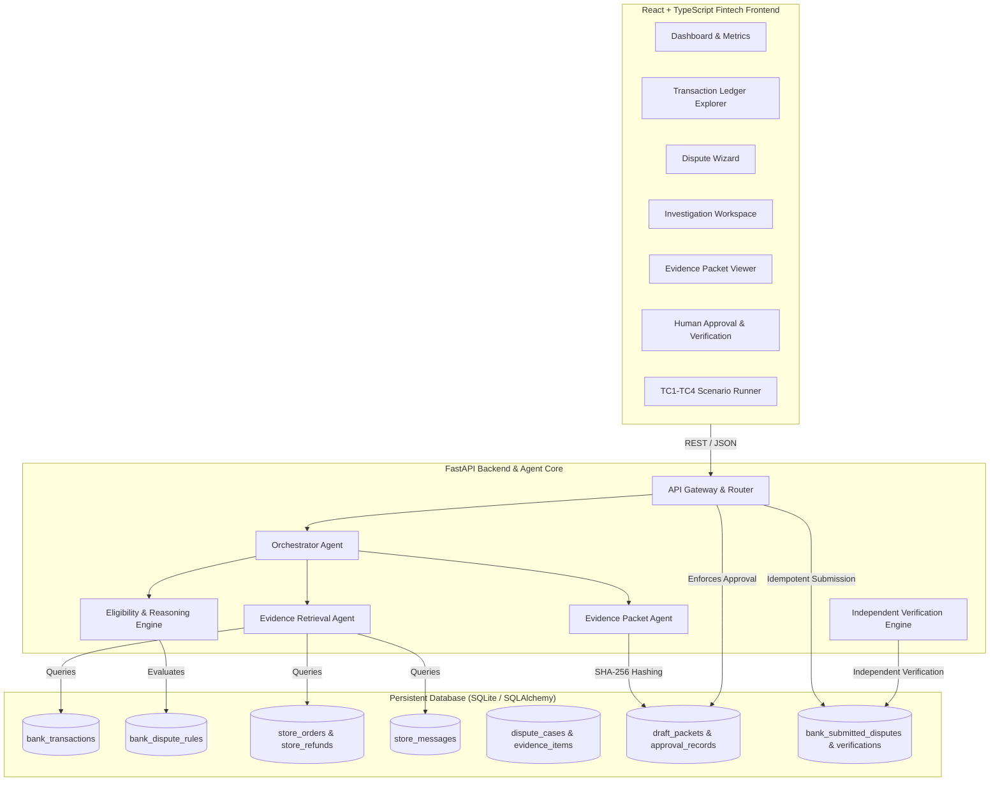

# EvidentAI — System Architecture

**Tagline:** Every Claim. Backed by Evidence.  
**Official Problem Statement:** Chargeback Evidence Assistant — FinTech & Financial AI  
**Event:** Agentic AI Hackathon 2026 by Ziro.Digital

---

## 1. High-Level Architecture Overview

EvidentAI is an agentic AI assistant designed to eliminate illegitimate card dispute claims, prevent duplicate chargebacks, and construct cryptographically verified, human-approved dispute packets for genuine grievances.

---

## 2. Agentic Workflow & Component Breakdown

### A. Orchestrator Agent
- Receives cardholder grievance requests and determines the multi-system investigation plan.
- Calls specialized backend tools across simulated banking core and merchant e-commerce platforms.
- Stores transparent tool execution logs with exact parameters, endpoints, and timestamps.
- Feeds retrieved items into the deterministic financial rule engine.
- Safely terminates or flags cases with `ALREADY_REFUNDED`, `OUTSIDE_DISPUTE_WINDOW`, or `NEEDS_MORE_EVIDENCE`.

### B. Evidence Retrieval Agent
- Queries `/api/mock-bank/transactions/{id}` to verify card authorization and settlement amounts.
- Queries `/api/mock-bank/dispute-rules` to obtain dynamic dispute deadlines (e.g., 60 days).
- Queries `/api/mock-store/orders/by-transaction/{id}` to verify order fulfillment and items.
- Queries `/api/mock-store/refunds` to detect if an ARN refund voucher already exists.
- Normalizes all retrieved evidence into an immutable schema retaining `source_system`, `source_record_id`, `source_endpoint`, `retrieval_timestamp`, and `relevance_explanation`.

### C. Eligibility & Reasoning Engine (Deterministic Financial Rules)
- **Zero Hallucination:** Critical financial rules (deadlines, amount reconciliation, refund detection) are written in deterministic Python code without relying on unconstrained LLM outputs.
- **States Handled:**
  - `READY_FOR_DRAFT`: Valid dispute window, matching amounts, unfulfilled order, merchant delay acknowledged.
  - `ALREADY_REFUNDED`: Merchant already issued full refund (TC2). Prevents duplicate chargebacks.
  - `NEEDS_MORE_EVIDENCE`: Unsupported fraud claims without police reports/affidavits (TC3).
  - `UNDER_REVIEW`: Active provisional credit identified; explicitly marked as non-final (TC4).
  - `OUTSIDE_DISPUTE_WINDOW`: Transaction age exceeds configurable bank window.
  - `BLOCKED`: Mismatch between claim amount/currency and banking ledger.

### D. Evidence Packet Agent
- Compiles structured draft packets strictly from verified evidence.
- Generates chronological incident timelines.
- Separates customer allegations from verified facts.
- Computes deterministic SHA-256 snapshots (`content_hash`) to guarantee data immutability.
- Generates downloadable official dispute packets in JSON and formatted PDF format.

### E. Independent Verification Component
- Operates independently from packet preparation and submission logic.
- Verifies post-submission state directly against mock bank records:
  1. Transaction ID match.
  2. Amount and currency exact match.
  3. Evidence references bound to the dispute.
  4. Idempotency check: Exactly-once submission guarantee.
  5. Bank network status check (`SUBMITTED_TO_NETWORK`).

---

## 3. Human Approval & Safe Actions Enforcement

1. **Backend Enforced:** An unapproved packet cannot be submitted via API, even if requested directly (HTTP 403 Forbidden).
2. **Snapshot Invalidation:** If packet contents are altered, the SHA-256 hash changes, automatically invalidating previous approvals.
3. **Idempotency Keys:** Every submission requires an idempotency key; repeated submissions are blocked with HTTP 409 Conflict.
